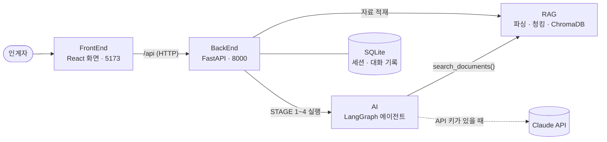

# AMIGO BackEnd — FastAPI API 서버

AI 기반 인수인계서 자동 작성 시스템 **AMIGO** 의 API 서버입니다.
화면(FrontEnd)의 요청을 받아 파일을 안전하게 저장하고 RAG 모듈에 넘겨 지식베이스를 만들며,
AI 에이전트를 백그라운드에서 실행하고, 세션·자료·대화 기록을 DB(SQLite/PostgreSQL)에 저장합니다.

> **설치·실행 스크립트가 이 저장소의 `scripts/` 에 있습니다.** 처음이라면 [실행 방법](#실행-방법)부터 따라 하세요.

<!-- 공통 섹션 시작 — 4개 저장소(RAG·AI·BackEnd·FrontEnd) README 에 같은 내용이 들어 있습니다. 고칠 때는 네 곳을 함께 고쳐 주세요. -->

## 전체 구성

AMIGO 는 인계자가 올린 업무 자료를 AI 가 먼저 분석하고, 자료에 없는 내용만 골라 한 번에 하나씩 질문해서
**근거(출처)가 달린 인수인계서**를 완성하는 시스템입니다. 저장소 네 개가 하나의 시스템을 이룹니다.



| 저장소 | 하는 일 | 주요 기술 |
|---|---|---|
| [FrontEnd](https://github.com/AMIGO-KFTC/FrontEnd) | 로그인·홈 대시보드, 인수인계 유형 선택, 자료 업로드(드래그 앤 드롭·링크), 분석 진행 표시, 메신저형 질의응답, 문서 뷰어·PDF/Word 다운로드 | React 19, Vite, TypeScript |
| **[BackEnd](https://github.com/AMIGO-KFTC/BackEnd)** (이 저장소) | API 서버, 세션·자료·대화 DB, 업로드 파일 보관 → RAG 적재, 에이전트 백그라운드 실행, 문서 내보내기 | FastAPI, SQLAlchemy |
| [AI](https://github.com/AMIGO-KFTC/AI) | STAGE 1~4 상태 머신, 빈 항목 질문, 검색 도구 호출(Agentic RAG), 근거가 달린 문서 합성 | LangGraph, Claude API |
| [RAG](https://github.com/AMIGO-KFTC/RAG) | PDF·HWPX·Word·메일 등 파싱, 청킹·출처 메타데이터, 하이브리드 검색 `search_documents()` | ChromaDB, pdfplumber |

BackEnd 가 AI·RAG 를 **파이썬 패키지로 불러와** 한 프로세스에서 함께 실행합니다.
그래서 띄울 서버는 **BackEnd(8000 포트)** 와 **FrontEnd 개발 서버(5173 포트)** 두 개뿐입니다.

| 단계 | 화면 | 하는 일 |
|---|---|---|
| STAGE 1 자료 분석 | 진행률 바 | 인수인계서 장(인사발령 6개: 업무 단위 요약·정기업무·비정기 업무·협업관계 표·시스템 접근 권한·부서별 추가 자료 / 장기휴가 3개: 세부 업무·시스템 접근 권한·주요 연락망)별로 자료를 검색하고, 모자라면 AI 가 스스로 다시 검색 |
| STAGE 2 분석 요약 | 장별 🟢충분 🟡부분 🔴부족 | 자료로 채운 것과 비어 있는 것을 정리 |
| STAGE 3 질의응답 | 메신저형 채팅 | 빈 항목을 중요한 순서대로 **한 번에 하나씩** 질문 → 답변 정리 → "이렇게 정리했는데 맞나요?" 교차 확인 |
| STAGE 4 문서 생성 | 인수인계서 탭 | 표와 근거 번호가 달린 문서, PDF/Word 다운로드, 채팅으로 고칠 점을 말하면 새 버전 생성 |

## 실행 방법

처음 받는 사람 기준으로 **설치 → 실행 → 데모**를 순서대로 정리했습니다. 패키지를 내려받는 첫 설치는 보통 5분 안팎 걸립니다.
API 키가 없어도 규칙 기반 **오프라인 엔진**으로 전체 흐름이 동작합니다. Claude 를 쓰려면 [3. 환경 설정](#3-환경-설정-env)에서 키만 넣으면 됩니다.

### 0. 준비물

| 도구 | 버전 | 설치 |
|---|---|---|
| Git | 아무 버전 | <https://git-scm.com> |
| Python | **3.11 ~ 3.13** (3.12 권장) | macOS: `brew install python@3.12`<br>Ubuntu 24.04: `sudo apt install python3 python3-venv`<br>Windows: <https://www.python.org/downloads/> — 설치 첫 화면에서 **Add python.exe to PATH** 체크 |
| Node.js | **22 LTS** (20.19 이상) | <https://nodejs.org> 에서 LTS 버전, macOS: `brew install node@22` |
| Claude API 키 | 선택 | <https://console.anthropic.com> 에서 발급. 없으면 오프라인 엔진으로 동작 |

설치 확인: `git --version`, `python3 --version`(Windows: `python --version`), `node --version`

- 디스크 여유 공간 약 1GB(파이썬 패키지 약 650MB, npm 패키지 약 160MB)가 필요하고, 첫 설치 때 PyPI·npm 에 접속합니다.
  사내망에서 막히면 [8. 문제 해결](#8-문제-해결)의 프록시·미러 설정을 보세요.
- macOS 에 기본으로 들어 있는 `python3`(3.9)는 쓸 수 없습니다. 위 명령으로 3.12 를 설치하면 설치 스크립트가 알아서 찾아 씁니다.

### 1. 저장소 받기

네 저장소를 **한 폴더 안에 나란히** 받습니다. BackEnd 가 `../RAG`, `../AI`, `../FrontEnd` 경로로 나머지를 찾으므로 폴더 이름을 바꾸지 마세요.

```bash
mkdir amigo && cd amigo
git clone https://github.com/AMIGO-KFTC/RAG.git
git clone https://github.com/AMIGO-KFTC/AI.git
git clone https://github.com/AMIGO-KFTC/BackEnd.git
git clone https://github.com/AMIGO-KFTC/FrontEnd.git
```

```text
amigo/
├── RAG/        문서 파싱 · 검색 모듈
├── AI/         LangGraph 에이전트
├── BackEnd/    API 서버  ← 설치·실행 스크립트가 여기에 있습니다
└── FrontEnd/   화면
```

> 기본 브랜치가 아닌 브랜치(예: 아직 병합 전인 작업 브랜치)로 실행하려면 받은 뒤 각 폴더에서 `git switch <브랜치명>` 을 실행하세요.

### 2. 설치 (처음 한 번)

BackEnd 의 설치 스크립트가 다음을 한 번에 처리합니다.

1. RAG·AI 저장소가 옆에 있는지 확인
2. 파이썬 가상환경 `BackEnd/.venv` 를 만들고 RAG·AI·BackEnd 패키지를 설치
   (RAG·AI 는 *editable* 설치라서 코드를 고치면 다시 설치하지 않아도 바로 반영됩니다)
3. `BackEnd/.env` 가 없으면 `.env.example` 을 복사
4. FrontEnd 의 npm 패키지 설치

**macOS / Linux**

```bash
cd BackEnd
./scripts/setup.sh
```

**Windows (PowerShell)**

```powershell
cd BackEnd
powershell -ExecutionPolicy Bypass -File scripts\setup.ps1
```

마지막에 `✔ 준비 완료`(Windows 는 `Done.`)가 보이면 성공입니다. 다시 실행해도 안전합니다(있는 것은 그대로 두고 빠진 패키지만 설치).
파이썬이 여러 개 깔려 있으면 쓸 파이썬을 지정할 수 있습니다: `PYTHON=python3.12 ./scripts/setup.sh`
(Windows: `powershell -ExecutionPolicy Bypass -File scripts\setup.ps1 -Python C:\경로\python.exe`)

<details>
<summary>스크립트 없이 직접 설치하기</summary>

macOS / Linux:

```bash
cd BackEnd
python3.12 -m venv .venv
source .venv/bin/activate
python -m pip install --upgrade pip
pip install -r requirements-dev.txt      # -e ../RAG, -e ../AI 가 함께 설치됩니다
cp .env.example .env
cd ../FrontEnd && npm install
```

Windows (PowerShell):

```powershell
cd BackEnd
py -3.12 -m venv .venv
.venv\Scripts\Activate.ps1
python -m pip install --upgrade pip
pip install -r requirements-dev.txt
copy .env.example .env
cd ..\FrontEnd; npm install
```

</details>

### 3. 환경 설정 (.env)

설정 파일은 `BackEnd/.env` 하나입니다. **처음에는 그대로 두고 실행해도 됩니다.**

| 하고 싶은 것 | `BackEnd/.env` 에 적을 내용 |
|---|---|
| API 키 없이 시연 (기본) | 그대로 두기 → 규칙 기반 오프라인 엔진 |
| Claude 로 실제 분석 | `ANTHROPIC_API_KEY=sk-ant-...` |
| 모델 바꾸기 | `AMIGO_LLM_MODEL=claude-haiku-4-5`(기본, 가장 저렴) / `claude-sonnet-5-5`(약 2배) / `claude-opus-5-5`(약 4배, 품질 가장 좋음) |
| 키가 있어도 오프라인 엔진으로 | `AMIGO_LLM_MODE=offline` |
| Claude API 비용 상한 두기 | `AMIGO_LLM_BUDGET_USD=10` (모든 작업 합계가 $10 를 넘으면 새 AI 작업을 막음, 0 이면 제한 없음) |
| 컨플루언스 링크 수집 | `CONFLUENCE_BASE_URL` + `CONFLUENCE_PAT`(Server/DC), Cloud 는 `CONFLUENCE_EMAIL` + `CONFLUENCE_API_TOKEN` |
| 나누미 링크 수집 | `NANUMI_BASE_URL` + `NANUMI_COOKIE` |

- Claude 사용량은 <http://localhost:8000/api/usage> 에서 **전체 누적 추정 비용·토큰 수와 남은 예산**을, 각 작업의 사용량은 `GET /api/sessions/{id}/state` 응답의 `usage` 로 확인합니다(새 디자인 화면에는 아직 사용량 배지가 없습니다). 추정치이므로 실제 청구액은 <https://platform.claude.com> 의 Usage 에서 확인하고, 그곳의 Limits 에서 월 사용 한도도 걸어 두세요.
- `.env` 를 고친 뒤에는 백엔드를 껐다가 다시 켭니다(코드 변경 시 자동 재시작은 `.env` 변경을 감지하지 않습니다).
- 지금 쓰는 엔진은 <http://localhost:8000/api/health> 의 `"engine"` 값(`claude` / `offline`)으로 확인합니다.
- `.env` 는 `.gitignore` 에 들어 있어 커밋되지 않습니다. API 키를 `.env.example`·코드·채팅에 적지 마세요.
- 오프라인 엔진은 표 머리글과 정규식으로 항목을 뽑는 **시연용**이라 문장이 거칠고 질문도 정해진 틀을 씁니다. 실제 품질은 Claude 로 확인하세요.
- 전체 설정 목록은 [BackEnd README 의 환경변수](https://github.com/AMIGO-KFTC/BackEnd#환경변수)에 있습니다.

### 4. 실행

터미널을 두 개 열어 백엔드와 프론트엔드를 각각 실행합니다.

**터미널 1 — 백엔드(API 서버)**

macOS / Linux:

```bash
cd BackEnd
./scripts/dev.sh
```

Windows (PowerShell):

```powershell
cd BackEnd
powershell -ExecutionPolicy Bypass -File scripts\dev.ps1
```

`Application startup complete.` 가 보이면 준비된 것입니다. <http://localhost:8000/docs> 에서 API 문서(Swagger)를 볼 수 있습니다.

**터미널 2 — 프론트엔드(화면)** — 모든 OS 공통

```bash
cd FrontEnd
npm run dev
```

브라우저에서 **<http://localhost:5173>** 을 엽니다. 화면의 `/api` 요청은 Vite 개발 서버가 백엔드(8000)로 전달합니다.

**한 번에 실행하기** — 둘 다 띄우는 스크립트도 있습니다.

macOS / Linux: 터미널 하나에서 함께 실행되고 `Ctrl+C` 로 둘 다 종료됩니다.

```bash
cd BackEnd
./scripts/start-all.sh
```

Windows (PowerShell): 백엔드·프론트엔드 창이 하나씩 새로 열립니다.

```powershell
cd BackEnd
powershell -ExecutionPolicy Bypass -File scripts\start-all.ps1
```

- **코드를 고치면** 바로 반영됩니다. 백엔드는 BackEnd·AI·RAG 의 `.py` 파일이 바뀌면 스스로 다시 시작하고, 화면은 저장하는 즉시 바뀝니다.
- 끌 때는 각 터미널에서 `Ctrl+C` 를 누릅니다.
- **8000 포트를 이미 쓰고 있다면** 다른 포트로 띄우고, 프론트엔드에도 그 주소를 알려 줍니다(예: 8001).

| | macOS / Linux | Windows (PowerShell) |
|---|---|---|
| 백엔드 | `PORT=8001 ./scripts/dev.sh` | `powershell -ExecutionPolicy Bypass -File scripts\dev.ps1 -Port 8001` |
| 프론트엔드 | `AMIGO_API=http://localhost:8001 npm run dev` | `$env:AMIGO_API="http://localhost:8001"; npm run dev` |
| 함께 실행 | `PORT=8001 ./scripts/start-all.sh` | `powershell -ExecutionPolicy Bypass -File scripts\start-all.ps1 -Port 8001` |

### 5. 데모 따라 하기 (5분)

RAG 저장소의 `samples/` 폴더(`amigo/RAG/samples/`)에 가상의 웹서비스팀 인수인계 자료 6종이 있습니다(등장하는 기관·인물·연락처는 모두 가상).

| 파일 | 내용 |
|---|---|
| `업무정의서_웹서비스팀.pdf` | 업무 개요, 주요 업무·반복 업무 표, 유관 부서, 유의사항 |
| `홈페이지_운영매뉴얼.hwpx` | 한글 문서: 사용 시스템과 권한 신청 방법 |
| `주간회의록_2026-09-22.docx` | 진행 중인 과제 현황(리뉴얼, 개인정보처리방침 개정 등) |
| `재무팀_유지보수대금_요청.eml` | 재무팀 메일(발신자·일시 메타데이터) + 첨부 검수 체크리스트 |
| `시스템_계정목록.xlsx` | 시스템 계정 목록, 연간 일정 |
| `웹접근성_개선계획.pptx` | 웹 접근성 지적사항과 추진 일정 |

1. <http://localhost:5173> 에서 로그인합니다. 계정이 없으면 <http://localhost:8000/docs> 의 `POST /api/auth/signup` 에 아이디·비밀번호(8자 이상)·이름을 넣어 만듭니다
   (화면의 회원가입·비밀번호 재설정 양식은 아직 서버와 연결되지 않았습니다).
2. 홈에서 **새 인수인계 시작하기** → **정기인사 인수인계 시작** → 기본 정보를 적습니다. 이름·소속·직책은 프로필에서 채워지고, 담당 업무를 하나 이상 넣어야 다음으로 넘어갑니다.
3. 자료 등록 화면의 **파일 업로드** 칸에 `RAG/samples/` 의 파일 6개를 끌어다 놓습니다(칸을 클릭해서 골라도 됩니다). 등록한 자료 목록에서 모두 처리 완료가 될 때까지 기다립니다.
   - **컨플루언스 & 나누미 연결** 에 주소를 붙여 넣으면 링크도 자료로 등록됩니다.
     접속할 수 없는 주소면 실패 표시와 사유가 나오고, 나머지 자료만으로 계속 진행할 수 있습니다.
   - **메신저 & 매터모스트** 는 BackEnd 의 가상 Mattermost·Confluence 데이터를 보여 주며, 체크해서 자료로 등록합니다.
4. **AI 분석 시작** → 분석 화면의 진행률이 STAGE 1(장별 분석) → STAGE 2(요약)로 올라가고, 끝나면 **질의응답 시작** 을 누릅니다.
5. STAGE 3 — 대화창에 첫 질문이 옵니다. 아는 내용을 자유롭게 답하면 AI 가 정리해서 맞는지 되묻습니다. 왼쪽 **확인할 질문** 목록과 **항목 충족 현황**이 함께 바뀝니다.
   - 예: 재무팀 연락처를 물으면 `재무팀 박지훈 차장, 내선 2345` 라고 답하기 → 정리된 내용 확인 → **네, 맞아요**
   - 틀렸으면 고칠 내용을 그대로 적고, 모르는 질문은 **이 질문 건너뛰기** 를 누릅니다.
6. 질문이 끝나거나 **지금까지 내용으로 생성하기** 를 누르면 STAGE 4 로 넘어가 생성 중 화면을 거쳐 **인수인계서**가 나타납니다.
7. 문서 위쪽 버튼으로 **PDF / Word / Markdown** 을 내려받습니다. 표의 `[1]` 같은 번호는 문서 끝 **근거 자료** 목록(파일명·페이지·메일 발신자)과 연결됩니다.
8. **수정 요청 보내기** 에 `협업 관계에 총무팀 최OO 주임(내선 3456)도 추가해 주세요` 처럼 고칠 점을 적으면 반영된 **v2** 문서가 만들어집니다.
9. **인수인계 완료하기** → 완료 화면 → **홈으로 돌아가기**. 완성된 문서는 홈의 **완성 문서**에서 다시 열 수 있습니다.

진행 상황은 서버에 저장되므로, 브라우저를 닫거나 서버를 다시 켜도 홈의 **진행 중인 인수인계**에서 **이어서 작성**으로 저장된 단계부터 계속할 수 있습니다.
작업 화면 주소(`#/s/<세션ID>/<단계>`)를 북마크해 두면 로그인 뒤 바로 그 화면으로 돌아옵니다.
각 화면의 구성과 주소, 서버 연동 방식은 [FrontEnd README 의 화면 구성](https://github.com/AMIGO-KFTC/FrontEnd#화면-구성)을 보세요.

### 6. (선택) 서버 하나로 실행하기 — 시연·공유용

화면을 빌드해 두면 백엔드가 화면까지 함께 제공하므로 8000 포트 하나로 동작합니다.

1. 화면 빌드: FrontEnd 폴더에서 `npm run build` → `FrontEnd/dist/` 가 생깁니다.
2. `BackEnd/.env` 에서 `# AMIGO_FRONTEND_DIST=../FrontEnd/dist` 줄 맨 앞의 `#` 을 지웁니다.
3. 백엔드를 [4. 실행](#4-실행)과 같이 띄우면 **<http://localhost:8000>** 에서 화면과 API 가 함께 열립니다.

같은 네트워크의 다른 PC 에서도 열어 보게 하려면 BackEnd 폴더에서 다음처럼 실행하고 `http://<내 PC IP>:8000` 으로 접속합니다.

```bash
.venv/bin/python -m uvicorn app.main:app --host 0.0.0.0 --port 8000        # Windows: .venv\Scripts\python -m uvicorn ...
```

로그인은 BackEnd 의 자체 계정(회원가입 API)으로만 동작하는 **프로토타입**이므로 사내망 시연에만 쓰고, 실제 업무 자료를 다루는 서버는 사내 SSO 를 붙이고 HTTPS(`AMIGO_COOKIE_SECURE=true`)로 운영하세요.

### 7. 테스트

모든 테스트는 오프라인 엔진으로 돌기 때문에 API 키 없이 실행됩니다. BackEnd 가상환경 하나로 세 파이썬 저장소를 모두 테스트할 수 있습니다.

macOS / Linux (amigo 폴더에서):

```bash
cd BackEnd     && .venv/bin/python -m pytest -q
cd ../RAG      && ../BackEnd/.venv/bin/python -m pytest -q
cd ../AI       && ../BackEnd/.venv/bin/python -m pytest -q
cd ../FrontEnd && npm run build
```

Windows (PowerShell, amigo 폴더에서):

```powershell
cd BackEnd;     .venv\Scripts\python -m pytest -q
cd ..\RAG;      ..\BackEnd\.venv\Scripts\python -m pytest -q
cd ..\AI;       ..\BackEnd\.venv\Scripts\python -m pytest -q
cd ..\FrontEnd; npm run build
```

| 저장소 | 확인하는 것 |
|---|---|
| BackEnd | 업로드 → 분석 → 질의응답 → 문서 생성 → 다운로드 API 통합 흐름, `.env` 읽기, Word/PDF 변환 |
| RAG | 형식별 파서(PDF·HWPX·HWP·Office·메일·ZIP), 청킹, 링크 수집 보안 검사, 하이브리드 검색 |
| AI | 상태 머신 전체 흐름(오프라인 엔진), 가짜 Anthropic 클라이언트로 Claude 호출 형식, 문서 렌더링 |
| FrontEnd | TypeScript 타입 검사 + 프로덕션 빌드 |

### 8. 문제 해결

| 증상 | 해결 |
|---|---|
| 설치 스크립트가 `RAG 가 없습니다` / `-e ../RAG` 설치 실패 | 네 저장소를 같은 폴더에 받았는지, 폴더 이름이 정확히 `RAG`, `AI`, `BackEnd`, `FrontEnd` 인지 확인 |
| `Python 3.9 은(는) 지원하지 않습니다` | Python 3.12 를 설치한 뒤 `PYTHON=python3.12 ./scripts/setup.sh` |
| Ubuntu: `ensurepip is not available` | `sudo apt install python3-venv`(3.12 를 따로 설치했다면 `python3.12-venv`) 후 다시 실행 |
| Windows: `이 시스템에서 스크립트를 실행할 수 없으므로 …` | `.ps1` 은 안내대로 `powershell -ExecutionPolicy Bypass -File …` 로 실행합니다. `npm` 이나 `Activate.ps1` 에서 같은 오류가 나면 `Set-ExecutionPolicy -Scope CurrentUser RemoteSigned` 를 한 번 실행하거나 `npm.cmd run dev` 처럼 실행 |
| 사내망에서 `pip install` / `npm install` 이 멈추거나 SSL 오류 | 프록시: `pip config set global.proxy http://프록시:포트`, `npm config set proxy http://프록시:포트`, `npm config set https-proxy http://프록시:포트`<br>사내 미러: `pip config set global.index-url <미러 주소>`, `npm config set registry <미러 주소>`<br>SSL 검사 장비가 있으면 회사 인증서 지정: `pip config set global.cert <인증서.pem>`, `npm config set cafile <인증서.pem>` |
| `npm run dev` 가 Node.js 버전 오류로 실패 | Node.js 22 LTS 로 올린 뒤 FrontEnd 에서 `npm install` 을 다시 실행 |
| 백엔드 실행 시 `address already in use` | 이미 떠 있는 서버를 끄거나 다른 포트로 실행([4. 실행](#4-실행)의 포트 변경 참고) |
| 화면에 `서버에 연결할 수 없습니다` | 백엔드가 떠 있는지 <http://localhost:8000/api/health> 로 확인. 포트를 바꿨다면 `AMIGO_API` 도 맞춰서 프론트엔드를 다시 실행 |
| 링크 등록이 실패(DNS·연결 오류) | 사내 위키·나누미는 사내망 PC 에서만 열립니다. 인증이 필요한 주소는 [3. 환경 설정](#3-환경-설정-env)의 컨플루언스·나누미 설정을 채우세요 |
| 내려받은 PDF 의 한글이 깨지거나 글꼴이 이상함 | 서버에 한글 TTF 글꼴이 없는 경우입니다. Linux: `sudo apt install fonts-nanum`, 또는 `.env` 에 `AMIGO_PDF_FONT=<글꼴 .ttf 경로>` 지정 후 백엔드 재시작 |
| `AI가 이전 요청을 처리하고 있어요` (409) | AI 가 앞 요청을 처리 중입니다. 대화창의 입력 중 표시(…)가 사라진 뒤 다시 보내세요 |
| 대화창에 오류 메시지와 **다시 시도** 버튼 | API 키·네트워크·사용량 한도 문제일 수 있습니다. 백엔드 터미널의 로그를 확인한 뒤 **다시 시도** |
| Linux 에서 `unsupported version of sqlite3` (ChromaDB) | 배포판의 sqlite 가 3.35 보다 오래된 경우입니다(Ubuntu 20.04, RHEL 8 등). Ubuntu 22.04 이상을 쓰거나 [uv](https://docs.astral.sh/uv/) 로 설치한 Python(`uv python install 3.12`)을 `PYTHON=` 으로 지정 |
| 처음 상태로 되돌리기 | 백엔드를 끄고 `BackEnd/data/` 폴더를 지우면 세션·업로드 파일·지식베이스가 모두 초기화됩니다 |

### 9. 최신 코드로 업데이트

네 저장소를 모두 최신으로 받은 뒤, 패키지가 바뀌었을 수 있으니 설치 스크립트를 한 번 더 실행합니다(이미 설치된 것은 건너뜀).

```bash
cd amigo
for repo in RAG AI BackEnd FrontEnd; do git -C $repo pull; done
cd BackEnd && ./scripts/setup.sh
```

Windows (PowerShell):

```powershell
cd amigo
foreach ($repo in "RAG", "AI", "BackEnd", "FrontEnd") { git -C $repo pull }
cd BackEnd; powershell -ExecutionPolicy Bypass -File scripts\setup.ps1
```

<!-- 공통 섹션 끝 -->

## 스크립트

| 하는 일 | macOS / Linux | Windows (PowerShell) |
|---|---|---|
| 설치: `.venv` 생성, RAG·AI·백엔드 패키지 설치, `.env` 생성, FrontEnd `npm install` | `./scripts/setup.sh` | `powershell -ExecutionPolicy Bypass -File scripts\setup.ps1` |
| 백엔드 실행(8000): 코드가 바뀌면 자동 재시작 | `./scripts/dev.sh` | `powershell -ExecutionPolicy Bypass -File scripts\dev.ps1` |
| 백엔드 + 프론트엔드(5173) 함께 실행 | `./scripts/start-all.sh` | `powershell -ExecutionPolicy Bypass -File scripts\start-all.ps1` |

- 파이썬 지정: `PYTHON=python3.12 ./scripts/setup.sh` / `setup.ps1 -Python <python.exe 경로>`
- 포트 지정: `PORT=8001 ./scripts/dev.sh` / `dev.ps1 -Port 8001` (`start-all` 도 같은 방식)
- `.ps1` 은 Windows PowerShell 5.1 에서도 글자가 깨지지 않도록 안내 문구를 영어로만 출력합니다.

스크립트 없이 실행하려면 BackEnd 폴더에서 `.venv/bin/python -m uvicorn app.main:app --reload --port 8000`
(Windows: `.venv\Scripts\python -m uvicorn app.main:app --reload --port 8000`)을 실행합니다.
DB·업로드 파일이 `./data` 에 생기므로 **반드시 BackEnd 폴더에서** 실행하세요.

## 가상 응답 모드 (FrontEnd 개발용)

실제 자료 분석·AI 호출 없이 **미리 준비한 예시 데이터로 응답**하는 모드입니다. API 경로·요청·응답 형식은 실제와 똑같아서,
FrontEnd 는 실제 데이터 연동 전에 이 모드에 붙여 개발하고, 나중에 설정만 끄면 실제 서버로 바뀝니다.

```bash
# macOS / Linux (BackEnd 폴더에서)
AMIGO_MOCK_MODE=true ./scripts/dev.sh
```

```powershell
# Windows (PowerShell, BackEnd 폴더에서)
$env:AMIGO_MOCK_MODE = "true"; powershell -ExecutionPolicy Bypass -File scripts\dev.ps1
```

`.env` 에 `AMIGO_MOCK_MODE=true` 를 적어도 됩니다. 켜지면 서버 로그에 경고가 한 줄 나오고, 모든 응답에 `X-AMIGO-Mock: true` 헤더가,
`/api/health`·`/api/config` 에 `"mock": true` 가 붙습니다.

| 항목 | 가상 응답 모드에서 |
|---|---|
| 데모 계정 | `demo` / `demo1234` (김민수 · 디지털전략부 웹서비스팀 과장, 이메일 `minsu.kim@amigo.example`), 관리자 `admin` / `admin1234`. 같은 팀원 `seoyeon.lee`·`junho.park`(비밀번호 `demo1234`)도 있어 관리자 페이지의 팀 현황을 볼 수 있음. 단위업무 3건이 미리 들어 있음: **문서 완성**(기관 홈페이지 운영) · **질문에 답할 차례**(웹 접근성 관리) · **자료 올리기 전**(유지보수 계약 관리) |
| 회원가입·로그인·프로필·단위업무 | 실제와 같이 동작(검증 규칙·오류 코드 동일). 데이터는 임시 DB 에만 저장 |
| 파일 업로드 | 형식·크기 검사는 실제와 같고, 내용은 읽지 않고 '읽은 것처럼' 처리. 파일 이름에 `실패` 또는 `fail` 이 들어 있으면 처리 실패(`failed`)를 흉내 냄 |
| AI 분석·질의응답 | 예시 시나리오(기관 홈페이지 운영)로 장별 진행률 → 분석 요약 → 질문 6개 → 답변 정리 확인 → 문서 생성까지 실제와 같은 메시지·단계로 진행. 답변·고쳐 말하기·"네"·건너뛰기·지금 문서 생성·검토 의견(새 버전) 모두 반응 |
| 인수인계서 | 실제 양식 렌더러로 만든 문서(관계도·근거 번호 포함), PDF·Word·Markdown 내려받기 가능 |
| 저장 | 서버를 켤 때마다 임시 폴더에 새 DB 를 만들고 끌 때 지움. 실제 `data/` 폴더와 `AMIGO_DATABASE_URL` 은 건드리지 않음 |

- 단계 사이 대기 시간은 `AMIGO_MOCK_DELAY`(기본 0.4초)로 바꿉니다. 0 이면 바로 응답합니다.
- 빈 상태로 시작하려면 `AMIGO_MOCK_SEED=false` (데모 계정 없음, 회원가입부터).
- 모든 단위업무가 같은 예시 시나리오를 씁니다(업무 소개의 업무명만 단위업무 이름으로 바뀜).

## API 직접 호출해 보기

<http://localhost:8000/docs>(Swagger)에서 **Try it out** 버튼으로 호출해 볼 수 있습니다.
로그인이 필요한 API 는 로그인 응답의 `token` 을 오른쪽 위 **Authorize** 에 넣으면 됩니다.

### 로그인 → 프로필 → 단위업무 → 업무파일 업로드

```bash
API=http://localhost:8000/api
JAR=/tmp/amigo-cookie   # 로그인 쿠키(amigo_session)를 저장할 파일

# 1) 회원가입(처음 한 번) → 로그인: 성공하면 {"success": true, "message": "김민수님, 환영합니다.", "name": "김민수", "token": ...}
curl -s -X POST $API/auth/signup -H "Content-Type: application/json" \
  -d '{"login_id": "minsu", "password": "pass-1234", "name": "김민수"}'
curl -s -c $JAR -X POST $API/auth/login -H "Content-Type: application/json" \
  -d '{"login_id": "minsu", "password": "pass-1234"}'

# 2) 프로필 입력(부서·직위·팀·이름)
curl -s -b $JAR -X PUT $API/profile -H "Content-Type: application/json" \
  -d '{"department": "디지털전략부", "team": "웹서비스팀", "position": "과장", "name": "김민수"}'

# 3) 단위업무 입력(여러 건) → 응답의 tasks[].id 와 tasks[].session_id 를 기억
curl -s -b $JAR -X POST $API/unit-tasks -H "Content-Type: application/json" \
  -d '{"tasks": [{"name": "홈페이지 운영", "description": "기관 홈페이지 콘텐츠 관리", "successor": "이서연 대리", "handover_date": "2026-10-30"}, {"name": "웹 접근성 관리", "mode": "leave"}]}'
TASK=<tasks[0].id>; SESSION=<tasks[0].session_id>

# 4) 업무파일 업로드 → 원본을 DB 에 저장하고, 적재가 끝나면 AI 분석이 자동으로 시작됨
curl -s -b $JAR -X POST $API/unit-tasks/$TASK/files \
  -F "files=@../RAG/samples/업무정의서_웹서비스팀.pdf" -F "files=@../RAG/samples/주간회의록_2026-09-22.docx"

# 5) 이후 질의응답·문서 생성은 아래 '세션 API' 의 5)~8) 을 같은 쿠키(-b $JAR)로 호출
curl -s -b $JAR "$API/sessions/$SESSION/state?after=0" | python3 -m json.tool --no-ensure-ascii

# 6) 다시 접속했을 때: 내 대화들이 어디까지 진행됐는지, 그리고 한 대화를 멈춘 곳 그대로 불러오기
curl -s -b $JAR $API/conversations | python3 -m json.tool --no-ensure-ascii
curl -s -b $JAR "$API/conversations/$SESSION?limit=50" | python3 -m json.tool --no-ensure-ascii

# 7) 문서가 나온 뒤: 근거 번호별 원문(문서의 [1], [2] … 와 같은 번호)
curl -s -b $JAR $API/sessions/$SESSION/citations | python3 -m json.tool --no-ensure-ascii
```

### 세션 API(로그인 없이 쓰는 기존 흐름)

터미널에서는 다음 순서로 화면과 같은 흐름을 재현할 수 있습니다(macOS/Linux, BackEnd 폴더에서 실행).

```bash
API=http://localhost:8000/api

# 1) 세션 만들기(인계자 기초 정보) → 응답의 id 를 SESSION 에 저장
SESSION=$(curl -s -X POST $API/sessions -H "Content-Type: application/json" \
  -d '{"owner_name": "김민수", "organization": "디지털전략부 웹서비스팀", "duties": "기관 홈페이지 운영"}' \
  | python3 -c "import sys, json; print(json.load(sys.stdin)['id'])")

# 2) 자료 업로드(파일마다 -F files=@경로) → 백그라운드에서 파싱·적재
curl -s -X POST $API/sessions/$SESSION/upload \
  -F "files=@../RAG/samples/업무정의서_웹서비스팀.pdf" \
  -F "files=@../RAG/samples/주간회의록_2026-09-22.docx"

# 3) 자료 상태: 모두 "status":"ready" 가 되면 다음 단계로(몇 초 걸림)
curl -s $API/sessions/$SESSION/sources

# 4) 분석 시작 → 202 를 바로 돌려주고 백그라운드에서 STAGE 1 → 2 → 첫 질문
curl -s -X POST $API/sessions/$SESSION/analyze

# 5) 진행 상황 폴링: session.status 가 "waiting" 이면 messages 에 AI 질문이 와 있음
curl -s "$API/sessions/$SESSION/state?after=0" | python3 -m json.tool --no-ensure-ascii

# 6) 답변 보내기 → 다시 5) 로 확인(정리한 내용이 맞는지 되묻는 메시지가 옴)
curl -s -X POST $API/sessions/$SESSION/chat -H "Content-Type: application/json" \
  -d '{"text": "재무팀 담당자는 박지훈 차장이고 내선 2345 입니다"}'

# 7) 지금까지 내용으로 문서 생성(STAGE 4) → 5) 에서 session.document_version 이 1 이 되면 완료
curl -s -X POST $API/sessions/$SESSION/generate

# 8) 생성된 문서(Markdown) 보기, 내려받기(format=pdf | docx | md)
curl -s $API/sessions/$SESSION/document | python3 -c "import sys, json; print(json.load(sys.stdin)['markdown'])"
curl -s -o 인수인계서.pdf "$API/sessions/$SESSION/download?format=pdf"
```

AI 가 처리 중(`status` 가 `running`)일 때 6)·7) 을 보내면 `409` 가 돌아옵니다. 5) 로 상태를 확인한 뒤 보내세요.

## API

### 로그인 · 프로필 · 단위업무 · 업무파일

모든 응답에 `success`(true/false)와 화면에 그대로 띄울 `message` 가 들어 있습니다.
실패(4xx)도 `{"success": false, "message": "아이디 또는 비밀번호가 올바르지 않습니다.", "detail": ...}` 모양으로 옵니다.
`/api/auth/signup`·`/api/auth/login`·`/api/auth/password/*` 를 뺀 아래 API 는 로그인이 필요합니다(쿠키 `amigo_session` 또는 `Authorization: Bearer <token>`, 없으면 `401`).

| 메서드 | 경로 | 설명 |
|---|---|---|
| POST | `/api/auth/signup` | 회원가입 `{"login_id", "password"(8자 이상), "name", "email"(선택, 비밀번호 찾기용)}` (`AMIGO_ALLOW_SIGNUP=false` 면 `403`, 같은 이메일이면 `409`) |
| POST | `/api/auth/login` | 로그인 `{"login_id", "password"}` → `{"success", "message", "name", "user", "token", "expires_at"}` + HttpOnly 쿠키. 실패하면 `401` |
| POST | `/api/auth/logout` | 로그아웃(로그인 세션 삭제, 쿠키 제거) |
| GET | `/api/auth/me` | 로그인한 사용자와 프로필. `user.is_admin` 으로 관리자인지 안다(로그인 응답의 `user` 에도 있음) |
| POST | `/api/auth/password/forgot` | 비밀번호 찾기 `{"login_id", "email"}` → 맞으면 재설정 안내(가상 발송). 틀려도 같은 응답 |
| POST | `/api/auth/password/reset` | 비밀번호 재설정 `{"token", "new_password"}` → 모든 기기 로그아웃, 토큰은 한 번만 |
| GET / PUT | `/api/profile` | 프로필 조회 / 입력·수정 `{"department", "position", "team", "name"}` |
| POST | `/api/unit-tasks` | 단위업무 입력 `{"tasks": [{"name", "description", "mode", "successor", "handover_date"}]}` (프로필 먼저, 같은 이름은 `409`). `mode`: `reassignment`(인사발령, 6개 장, 기본) / `leave`(장기휴가 Light, 4개 장) |
| GET | `/api/unit-tasks[/{task_id}]` | 단위업무 목록 / 상세(`session_id`, 단계, 상태, 파일 수, 문서 버전) |
| PATCH / DELETE | `/api/unit-tasks/{task_id}` | 이름·설명·인계 유형·인수자·인계일 수정(분석 뒤 유형을 바꾸면 '다시 분석' 필요) / 삭제(파일·지식베이스·대화·문서 포함) |
| POST | `/api/unit-tasks/{task_id}/files` | 업무파일 업로드(multipart `files`) → **원본 DB 저장** → 적재 → **AI 분석 자동 시작** |
| GET | `/api/unit-tasks/{task_id}/files[/{file_id}]` | 파일 목록(처리 상태) / DB 에 저장된 원본 내려받기 |

단위업무마다 인수인계 세션이 하나씩 만들어집니다(응답의 `session_id`). 업로드 뒤 진행 상황 폴링, AI 질문에 답하기,
문서 생성·내려받기는 아래 세션 API(`/api/sessions/{session_id}/state`, `/chat`, `/generate`, `/download` …)를 그대로 씁니다.
로그인 계정이 만든 세션은 그 계정만 접근할 수 있습니다(로그인 안 하면 `401`, 다른 계정이면 `404`).

### 마이페이지 · 비밀번호 · 관리자

| 메서드 | 경로 | 설명 |
|---|---|---|
| GET | `/api/me` | 마이페이지: 내 정보(아이디·이름·이메일·부서·팀명·직위·관리자 여부), 가입·마지막 로그인·비밀번호 변경 시각, 작성 현황(단위업무·인수인계서·버전 수) |
| PATCH | `/api/me` | **내 정보 수정**: `{"name", "department", "team", "position", "email"}` 중 보낸 항목만 바꿈. 단위업무 인수인계서의 인계자 정보에도 반영. 관리자 권한은 바꿀 수 없음 |
| PUT | `/api/me/password` | **비밀번호 바꾸기** `{"current_password", "new_password"}` → 지금 기기를 뺀 다른 기기 로그아웃 |
| GET | `/api/admin/users?q=&admin_only=&page=&size=` | (관리자) 회원 목록: 관리자 여부·가입일·마지막 로그인·단위업무·인수인계서 수 |
| PATCH | `/api/admin/users/{user_id}/role` | (관리자) 관리자 권한 주기·빼기 `{"is_admin": true}` (자기 권한은 뺄 수 없음) |
| POST | `/api/admin/users/{user_id}/password-reset` | (관리자) 메일을 받을 수 없는 회원용 재설정 토큰 발급(한 번만 보여 줌) |
| GET | `/api/admin/teams` | (관리자) 팀 목록: 프로필의 부서·팀명별 팀원 수, 단위업무 수, 인수인계서 수, 작성 완료율 |
| GET | `/api/admin/teams/report?department=&team=&date_from=&date_to=` | (관리자) **팀 인수인계 현황**: 팀 합계와 팀원별 작성 수행 기록·성과(아래 지표). 기간은 단위업무 등록일 기준 |
| GET | `/api/admin/members/{user_id}/report` | (관리자) 팀원 상세: 단위업무별 진행 단계·질문·충족률·버전, 최근 수행 기록(단위업무 등록·자료 등록·답변·문서 작성/수정, 최근 50건, 답변 내용은 빼고) |

- **팀 인수인계 현황 지표**(팀원별, 팀 합계도 같은 기준)
  - 진행 단계: 자료 준비 · AI 분석 중 · 질의응답/작성 중 · 완성(검토 단계)별 단위업무 수
  - 작성 완료율 = 인수인계서가 만들어진 단위업무 / 전체 단위업무
  - 질문 응답률 = 답한 질문 / (답한 + 건너뛴 질문), 남은 질문 수
  - 항목 충족률 = 분석이 끝난 단위업무의 장별 충족도 평균(충분 1 · 부분 0.5 · 부족 0)
  - 첫 문서까지 걸린 시간 = 단위업무 등록부터 첫 인수인계서까지(평균, 시간)
  - 등록 자료 수 · 답변 수 · AI 버전 수 · 직접 수정 버전 수 · 마지막 작업 시각 · Claude API 추정 비용
  - 계산은 `app/services/reports.py` 에 있습니다.
- **관리자 권한**은 `users.is_admin` 컬럼입니다. 관리자가 아니면 `/api/admin/*` 는 `403` 입니다.
  처음 관리자는 DB 에서 직접 지정하고(예: `UPDATE users SET is_admin = TRUE WHERE login_id = 'minsu.kim';`, SQLite 는 `TRUE` 대신 `1`),
  그 뒤에는 관리자가 위 API 로 주고 뺍니다. 가상 응답 모드에는 관리자 계정 `admin` / `admin1234` 가 미리 있습니다.
- **비밀번호 찾기**는 아이디와 등록한 이메일이 맞을 때 재설정 토큰(유효 30분, `AMIGO_PASSWORD_RESET_TTL_MINUTES`)을 만들어
  `AMIGO_PASSWORD_RESET_URL` 링크로 안내합니다. **아직 실제 메일은 보내지 않습니다**(사내 메일 연동 전, `app/services/accounts.py` 의 `ResetNotifier`).
  개발할 때는 `AMIGO_EXPOSE_RESET_TOKEN=true`(가상 응답 모드는 자동)로 응답에 토큰을 받아 바로 재설정할 수 있고, 운영에서는 관리자 발급 토큰을 쓰세요.
- 재설정 토큰은 SHA-256 만 저장하고, 새로 받으면 이전 토큰은 못 쓰며, 비밀번호를 바꾸면 남은 토큰도 지웁니다. 아직 요청 횟수 제한은 없습니다.

### 대화 진행 상태 · 기록 불러오기

로그인한 사용자가 각 대화(단위업무)를 **어디까지 진행했는지**와 **주고받은 기록**을 DB 에서 불러옵니다.
다시 접속했거나 서버가 재시작된 뒤에도 이 API 하나로 화면을 멈춘 곳 그대로 되살릴 수 있습니다.

| 메서드 | 경로 | 설명 |
|---|---|---|
| GET | `/api/conversations` | 내 대화 목록과 각각의 진행 상태(최근 활동 순) |
| GET | `/api/conversations/{session_id}?limit=50` | 대화 불러오기: 진행 상태 `progress` + 최근 메시지 `history` |
| GET | `/api/conversations/{session_id}/messages?before=<ID>&limit=50` | 더 오래된 기록 이어서 불러오기(`has_more_before`) |
| PUT | `/api/conversations/{session_id}/read` | 읽음 위치 저장 `{"message_id": 42}` (뒤로 돌아가지 않음) |

`progress` 에 들어 있는 값:

| 필드 | 뜻 |
|---|---|
| `stage`, `stage_number`, `stage_label` | 지금 단계(0 자료 준비 → 1 자료 분석 → 2 분석 요약 → 3 질의응답 → 4 문서 생성) |
| `status` | `idle` / `running`(AI 처리 중) / `waiting`(사용자 입력 대기) / `error` |
| `next_action`, `next_action_label` | 사용자가 할 일: `upload_files` · `processing_files` · `start_analysis` · `ai_working` · `answer_question` · `confirm_answer` · `reply` · `review_document` · `retry` 와 화면에 띄울 안내 문구 |
| `current_question` | 답을 기다리는 AI 질문(또는 정리한 답변 확인 요청): 메시지 ID, 내용, 몇 번째 질문인지, 빠른 답장 |
| `questions` | 질문한 수 · 답변 정리된 빈 항목 · 건너뛴 항목 · 남은 항목 · 전체 |
| `message_count`, `last_message`, `last_activity_at` | 대화 규모와 마지막 활동 |
| `last_read_message_id`, `unread_count` | 마지막으로 읽은 위치와 그 뒤 AI 가 보낸 새 메시지 수(AI 는 백그라운드로 일하므로 자리를 비운 사이 쌓인 메시지를 알 수 있음) |

### 인수인계서 직접 수정 · 버전 기록

AI 가 만든 초안과 사용자가 화면에서 직접 고친 문서를 모두 `document_versions` 에 **버전으로 쌓습니다.**
`GET /document` 는 항상 마지막 버전(직접 고쳤으면 고친 문서)을 돌려주므로, 다시 접속해도 고친 문서가 그대로 열립니다.

| 메서드 | 경로 | 설명 |
|---|---|---|
| GET | `/api/sessions/{id}/document` | 현재 인수인계서: `markdown`, `version`, `origin`(`ai`/`user`/`restore`), `origin_label`, `author_name`, `updated_at`, `version_count` |
| PUT | `/api/sessions/{id}/document` | 직접 고친 문서 저장 `{"markdown": "...", "base_version": 3, "note": "선택"}` → 새 버전. 그사이 버전이 바뀌었으면 `409`(덮어쓰기 방지), AI 처리 중이면 `409`, 내용이 같으면 `saved: false` |
| GET | `/api/sessions/{id}/document/versions` | 버전 기록(최신순, 본문 제외): 번호·출처(AI 작성/직접 수정/복원)·AI 초안 번호·기준 버전·메모·작성자·시각·현재 여부 |
| GET | `/api/sessions/{id}/document/versions/{version}` | 특정 버전 본문 |
| POST | `/api/sessions/{id}/document/versions/{version}/restore` | 이전 버전을 현재 문서로 복원(복원도 새 버전) `{"base_version": 4}` |
| GET | `/api/sessions/{id}/download?format=pdf\|docx\|md&version=2` | `version` 을 주면 그 버전을 내려받음(비우면 현재 문서) |
| GET | `/api/documents` | 로그인 계정이 지금까지 작성한 인수인계서 목록(단위업무·현재 버전·버전 수·최근 수정 시각) |

- 버전 번호는 세션 안에서 1부터 이어지는 BackEnd 기준 번호입니다(AI 초안 → 직접 수정 → AI 재작성 순으로 v1, v2, v3).
  AI 가 매긴 초안 번호는 `ai_version` 에 따로 남습니다.
- 직접 고친 뒤 채팅으로 수정을 요청하면 AI 는 정리된 내용(슬롯)으로 **새 초안**을 씁니다. 직접 고친 문서는 버전 기록에 남아 있어 복원할 수 있습니다.
- 저장·복원하면 대화 기록에 안내 메시지(`system`/`info`)가 남습니다.
- 이 기능 이전에 만든 문서(`sessions.document_md`)는 서버를 시작할 때 첫 버전으로 옮겨집니다.

### 인수인계서 전송(인계자 → 인수자) · 인수받은 내용

인계자가 **인수자 이름**을 입력해 자기 인수인계서를 보내면, 인수자는 마이페이지 **'인수받은 내용'**(인수 현황)에서 받은 산출물을 봅니다.

| 메서드 | 경로 | 설명 |
|---|---|---|
| GET | `/api/users/recipients?q=` | 인수자 찾기: 이름(일부)으로 회원 검색, 동명이인을 구별하도록 부서·팀·직위 포함(본인 제외) |
| POST | `/api/sessions/{id}/transfers` | 보내기 `{"recipient_name": "이서연", "message": "선택"}`. 이름이 같은 회원이 여럿이면 `409` + `detail.candidates` → 고른 `{"recipient_id": N}` 으로 다시 보냄. 문서가 없으면 `400`, 없는 이름이면 `404`, 본인은 `400` |
| GET | `/api/sessions/{id}/transfers` | 이 인수인계서를 보낸 기록(받는 사람·읽음 여부) |
| GET | `/api/me/sent` | 내가 보낸 인수인계서 전체 |
| GET | `/api/me/received?q=&unread_only=` | **인수받은 내용(인수 현황)**: 받은 인수인계서 목록, 보낸 사람(소속·직위)·업무명·버전·남긴 말·받은 시각·읽음 여부, `unread_count` |
| GET | `/api/me/received/{transfer_id}` | 받은 산출물 보기(Markdown). 처음 열면 읽음 처리 |
| GET | `/api/me/received/{transfer_id}/download?format=pdf\|docx\|md` | 받은 산출물 내려받기 |

- 인수자는 언제나 인계자의 **최신 인수인계서**를 봅니다. 보낸 뒤 인계자가 '직접 수정하기'로 고쳐 저장(`PUT /document`)하면
  인수 현황에도 고친 버전이 뜹니다: `document_version`(지금 버전) · `sent_version`(보낸 버전) · `updated_since_sent` · `updated_since_read`(열어 본 뒤 또 고침) ·
  `document_origin`(ai/user/restore) · `document_updated_at`. 보낸 시점 문서도 남겨 두어 `?sent=true` 로 보거나 내려받을 수 있습니다.
- 보내면 그 세션의 인수자 계정(`successor_login_id`)이 비어 있을 때 받는 사람으로 채워 `GET /api/handovers/received`(받은 인수인계)에도 나타납니다.
  인수자는 읽기만 할 수 있고(문서 수정·AI 작업은 인계자만), 인계자가 단위업무를 지우면 보낸 시점 문서로 계속 볼 수 있습니다.
- 보내면 인계자 대화 기록에 안내가 남고, 인수자 칸이 비어 있으면 받는 사람 이름으로 채웁니다.
- `/api/me` 의 `stats` 에 보낸 수(`sent_transfers`)·받은 수(`received_transfers`)·안 읽은 수(`received_unread`)가 있어 '인수받은 내용' 배지에 씁니다.
- 가상 응답 모드: 이서연이 '모바일 웹 운영' 인수인계서를 김민수(`demo`)에게 보내 둔 상태로 시작합니다.

### 메일 조회 API (가상 메일함)

업무 자료를 올릴 때 메일함에서 업무 메일을 찾아 골라 가져옵니다. 지금은 실제 메일 서버 대신 **가상 메일 조회 API**
(`app/services/mail.py` 의 `MockMailProvider`, 예시 메일 22건)를 연결해 두었고, 메일함은 로그인 계정 기준입니다(`<아이디>@amigo.example`).
실제 메일 시스템을 붙일 때는 같은 메서드(`search`, `get`)를 가진 클래스를 만들어 `Services.mail` 만 바꾸면 됩니다.

| 메서드 | 경로 | 설명 |
|---|---|---|
| GET | `/api/mail/messages?q=&subject=&person=&sender=&folder=inbox\|sent&date_from=&date_to=&has_attachments=&important=&task_id=&session_id=&page=1&size=20` | 메일 목록. `task_id`(또는 `session_id`)를 주면 단위업무 낱말로 **관련도순** 정렬(`relevance`, `recommended`)하고 이미 가져온 메일은 `imported: true` |
| GET | `/api/mail/messages/{message_id}` | 메일 상세(본문·참조·첨부 목록) |

검색 조건: `q` 는 제목·본문·보낸 사람·첨부 이름을 모두 찾고, `subject` 는 **제목에만**(띄어 쓴 낱말은 모두 포함), `person` 은 **보낸 사람·받는 사람·참조**의 이름·주소 일부에 맞는 메일만 찾습니다. `important=true` 는 중요 표시한 메일만입니다. 조건은 함께 쓰면 모두 맞아야 합니다. 화면의 새 탭 메일함(`#/pick/mail`)이 이 조건으로 검색하고, 고른 메일은 원래 창에서 위의 `POST …/mails` 로 가져옵니다.

| POST | `/api/unit-tasks/{task_id}/mails` | 고른 메일 가져오기 `{"message_ids": ["m-0001", ...]}`(최대 20건) → 파일 업로드와 똑같이 적재, 끝나면 AI 분석 자동 시작 |
| POST | `/api/sessions/{id}/mails` | 세션 흐름에서 가져오기(분석이 끝난 세션이면 새 자료로 재분석) |

가져온 메일은 표준 `.eml`(본문 + 첨부)로 만들어 업로드 파일과 같이 원본은 `file_blobs`, 파싱용 사본은 디스크에 둡니다.
자료 목록에서는 `kind: "file"`, `link_type: "mail"`, `url: "mail:<메일 ID>"` 로 구분되고, 같은 메일은 두 번 가져오지 않습니다(`skipped`).
RAG 메일 파서가 보낸 사람·받는 사람·일시·제목을 출처 표기로 쓰고 지원 형식의 첨부파일도 함께 읽습니다.

### 인수인계 챗봇 (올린 자료 · 인계자 답변 · 인수인계서 기반 질의응답)

인수인계자가 올린 파일·메일·링크, 인터뷰에서 한 인계자 답변, 완성된 인수인계서를 근거로 질문에 답합니다. 인수인계서는 근거 중 하나입니다.
질문마다 업무(세션)별 지식베이스를 검색하고, 인수인계서는 질문과 관련 있는 장만 골라 같은 근거 목록으로 Claude 에 줍니다(Claude 가 연결되지 않으면 관련 근거를 출처와 함께 그대로 보여 줍니다).
인수인계서에 붙은 근거 번호(`[1]`)는 챗봇이 풀 수 없으므로 내려받는 문서처럼 뺍니다(`strip_citation_marks`).

| 메서드 | 경로 | 설명 |
|---|---|---|
| GET | `/api/handover-chat/scopes` | 질문할 수 있는 업무 목록. `kind` 가 `mine`(내 업무: 올린 자료 `source_count`건 + 인수인계서 유무 `has_document`) 또는 `received`(인계자가 전송한 인수인계서) |
| POST | `/api/handover-chat` | `{"question", "history": [{"role","content"}], "scope_ids": [...]}` → `answer`(Markdown), `grounded`(자료에 근거가 있는지), `sources`(근거로 쓴 자료: 어느 업무인지 `scope_id`·`scope_task`(업무명)·`scope_kind`(mine/received)·`scope_owner`, 자료 `kind` = document·answer·mail·link·file·note, `label`, 올린 파일·메일이면 `source_id`), `searched`, `engine` |

- `scope_ids` 를 비우면 볼 수 있는 모든 업무에 묻습니다. 남의 업무 ID 는 404 입니다.
- **전달받은 인수인계(`received`)는 인수인계서만 근거**입니다. 인계자가 보낸 것은 인수인계서뿐이라 원본 자료·답변은 읽지 않습니다.
- `sources[].source_id` 로 `GET /api/sessions/{session_id}/sources/{source_id}/file` 을 불러 올린 파일·메일 원본을 받을 수 있습니다.
- 대화는 서버에 저장하지 않고 화면이 `history`(최근 8개만 사용)로 보냅니다. Claude 엔진이면 예산(`AMIGO_LLM_BUDGET_USD`) 한도에 막힙니다(챗봇 호출 비용은 아직 사용량 합계에 넣지 않습니다).

### 근거 원문 · 지식베이스

| 메서드 | 경로 | 설명 |
|---|---|---|
| GET | `/api/sessions/{id}/citations` | 인수인계서의 근거 번호(`[1]`, `[2]` …)별 출처·인용·**조각 원문**. 번호는 문서의 '근거 자료' 목록과 같음. `kind`: `document`(올린 자료) / `answer`(인계자 답변) |
| GET | `/api/sessions/{id}/sources/{source_id}/chunks?limit=50` | 올린 자료를 AI 가 읽은 조각 원문(페이지·시트·절 위치 포함) |
| POST | `/api/sessions/{id}/reindex` | 지식베이스 다시 적재: 처리 완료된 자료를 원본(디스크 사본 또는 DB 원본)으로 다시 넣음. 대화·정리된 내용은 그대로 |

임베딩 설정(`AMIGO_RAG_EMBEDDING`)을 바꿨거나 서버를 옮겨 `data/rag` 가 비었을 때를 위해, 서버가 시작할 때
'처리 완료된 자료인데 지식베이스에 조각이 없는' 경우를 찾아 자동으로 다시 적재합니다(`AMIGO_REINDEX_ON_START`).
다만 질의응답 중 지식베이스에 저장된 인계자 답변 원문은 원본 파일이 없어 다시 만들 수 없습니다(정리된 내용과 대화 기록은 DB 에 남아 있음).

### 가상 Mattermost · Confluence 연동

실제 Mattermost·Confluence API 는 쓸 수 없어 `app/mock/mattermost.py` · `app/mock/confluence.py` 의 예시 데이터(기관 홈페이지 운영 업무)로
같은 화면 흐름을 만듭니다. 가상 응답 모드가 아니어도 항상 예시 데이터를 돌려주며, 응답에 `"mock": true` 가 붙습니다.
실제 연동은 두 모듈의 `list_conversations` / `search_pages` 만 API 호출로 바꾸면 됩니다.

| 메서드 | 경로 | 설명 |
|---|---|---|
| GET | `/api/integrations/mattermost/conversations?q=&limit=50` | 최근 대화 목록(마지막 메시지 순): 채널·DM·그룹, 참여자, 메시지 수, 마지막 메시지. `q` 는 이름·참여자·메시지 내용 검색 |
| GET | `/api/integrations/mattermost/conversations/{id}` | 대화 내용(메시지 전체) |
| GET | `/api/integrations/confluence/search?q=&space=&limit=20` | 제목·본문·라벨에 검색어(띄어쓰기로 여러 개, 모두 포함)가 들어간 페이지. 제목 일치 → 최근 수정 순, `excerpt` 는 검색어 주변 발췌 |
| GET | `/api/integrations/confluence/pages/{id}` | 페이지 본문(Markdown) |

고른 대화·페이지는 아래 세션 API 로 자료 등록하면 업로드 파일과 같은 방식(DB 원본 + 디스크 사본 → 지식베이스 적재)으로 처리됩니다.

### 역할 · 구성원 · 받은 인수인계 · 관리자(팀장)

관리자(팀장)는 `users.is_admin` 이 참인 계정입니다. 회원가입은 일반 구성원으로 만들어지고, 처음 관리자는 DB 에서 지정하며 그 뒤에는 관리자 API(`PATCH /api/admin/users/{id}/role`)로 주고 뺍니다
(`scripts/seed_accounts.py` 가 시연용 계정 5개와 관리자 권한·인수인계 관계를 넣습니다). 로그인·`/api/auth/me` 응답의 `user.is_admin` 으로 화면이 팀 관리 모드를 열어 줍니다.

인계자가 단위업무·세션을 만들 때 인수자의 로그인 아이디(`successor_login_id`)를 적으면 그 계정의 **받은 인수인계**에 나타나고, 인수자는 그 세션을
**읽기만**(GET: 상태·문서·PDF 내려받기·근거) 할 수 있습니다. 팀 관리자는 같은 소속(부서 + 팀) 구성원의 세션을 같은 방식으로 읽을 수 있습니다.

| 메서드 | 경로 | 설명 |
|---|---|---|
| GET | `/api/members` | 프로필을 입력한 모든 계정(인수자 선택 목록). 로그인 필요 |
| GET | `/api/handovers/received` | 내가 인수자(`successor_login_id`)인 인수인계 목록(최근 순) |
| GET | `/api/admin/members` | 우리 팀(관리자와 같은 소속) 구성원과 인수인계 건수. 관리자가 아니면 `403`, 프로필이 없으면 `400` |
| GET | `/api/admin/handovers` | 우리 팀 구성원이 인계자인 인수인계 목록(인수자·질문 수·남은 항목 포함) |
| DELETE | `/api/admin/members/{user_id}` | 우리 팀 구성원 삭제(그 구성원의 인수인계·자료·문서 포함). 본인은 `400`, 다른 팀은 `404`, AI 처리 중이면 `409` |

시연용 계정(`scripts/seed_accounts.py`, 비밀번호는 스크립트 참고): IT아미고팀 팀장 김미고 `amigoteamjang` · 계장 김민준 `demo`(사번 1111111) · 계장 최환 `hwan`,
AI개발팀 팀장 최고미 `aiteamjang` · 계장 임윤희 `yunhui`. 인수인계는 김민준 → 임윤희, 임윤희 → 최환, 김미고 → 최고미 로 들어 있습니다.

### 부서별 특이사항 (AI 분석·질문·대화에 반영)

사내 '부서별 특이사항' 문서는 정보만 담은 형태입니다: **부서 / 중요문서 위치 / 관리 가맹점 / 라이센스 업체**. 보안상 저장소에 넣을 수 없어, 목업 데이터에 나오는 부서(소속 4곳: 디지털전략부 웹서비스팀·IT운영팀,
디지털본부 IT아미고팀·AI개발팀 / 협업 부서 7곳: 재무팀·정보보호팀·IT지원팀·법무팀·총무팀·홍보팀·인사팀)마다 같은 형태로 새로 쓴 **가상 예시**가 `app/resources/department_notes.json` 에 들어 있습니다
(가맹점·라이센스 업체가 없는 부서는 빈 목록). 실제 요약본을 쓰려면 같은 모양의 JSON 파일을 저장소 밖에 만들고 `AMIGO_DEPT_NOTES_FILE` 에 경로를 적습니다.

- 인수인계 세션의 소속(부서 + 팀, 공백·가운뎃점 차이는 무시)에 맞는 정보를 분석을 시작할 때(`start_analysis`) 인계자 정보의 `dept_notes` 로 AI 에 넘깁니다. 다른 부서의 정보는 협업 부서 참고용으로 함께 갑니다(`app/services/department_notes.py`).
- AI 는 '부서별 추가 자료' 장에서 이 부서가 관리하는 대상(라이센스 업체·관리 가맹점·중요 문서)이 자료에서 어떻게 관리되는지 찾아 항목으로 정리하고, 자료에 없으면 **관리 방식**(계약·갱신·담당자·점검 주기·최신본 관리)을 인계자에게 묻습니다. 위치·업체명처럼 이미 아는 정보는 다시 묻지 않습니다.
- 협업 장에서는 협업 부서의 정보도 참고하고, 대화창에서는 답변을 대상 이름의 '부서별 추가 자료' 항목으로 정리합니다. 이 정보는 항목의 근거가 아니며 근거 ID·민감 정보 원칙은 그대로입니다.
- 가상 응답 모드에서는 일반 질문 대신 라이센스 업체 → 가맹점 → 중요 문서 순으로 번갈아 관리 방식을 묻는 질문(최대 3개)이 나옵니다.

### 팀 인수인계서 지침 (관리자)

팀 관리자가 관리자 화면의 **팀 인수인계 항목** 메뉴에서 '우리 팀 인수인계서에 담는 항목'(이름 · 작성 안내)과 '팀 특징·작성 지침'(자유 글)을
적으면 소속(프로필의 부서 + 팀) 단위로 `team_guidelines` 테이블에 저장됩니다. 소속은 공백·가운뎃점(`·`)을 같게 보고 비교하므로, 프로필의 '디지털전략부 웹서비스팀' 과 화면의 새 인수인계 시작이 만드는 세션의 '디지털전략부 · 웹서비스팀' 이 같은 소속입니다. 로그인이 필요하고, 프로필에 부서·팀이 없으면 `400` 입니다.

| 메서드 | 경로 | 설명 |
|---|---|---|
| GET | `/api/team-guidelines/me` | 내 소속의 지침. `editable`(이 계정이 저장할 수 있는지)과 `prompt_preview`(AI 프롬프트에 들어가는 문구)를 함께 돌려줌 |
| PUT | `/api/team-guidelines/me` | 지침 저장 `{"items": [{"id", "name", "instruction"}], "notes", "prompt"}`. **보낸 필드만 바꿉니다**(항목 화면은 items·notes, AI 맞춤 설정 화면은 prompt 만 보냄). `prompt` 는 팀 전용 프롬프트(2,000자까지)로 AI 에 항목보다 앞서 전달됩니다. 항목 30개 · 이름 100자 · 안내 500자 · 팀 특징 2,000자 이하, 이름 중복은 `422`, 권한이 없으면 `403` |

**AI 프롬프트 반영** — 그 소속의 인수인계 세션이 AI 분석을 시작할 때(`start_analysis`) 저장된 지침을 인계자 정보의 `team_guidelines` 로 에이전트에 넘깁니다.
AI 쪽(`AI/src/amigo_agent/prompts.py` 의 `team_guidelines_block`)이 이를 장별 분석 프롬프트와 질의응답 프롬프트에 '우리 팀 인수인계서 지침' 구간으로 끼워 넣습니다.
지침이 비어 있으면 프롬프트는 이전과 똑같습니다. 항목은 '자료에 있으면 이 이름으로 정리하라'는 안내일 뿐이라, 팀 관리자가 항목을 적지 않았거나 자료에 없으면 그냥 비워 두고 그 때문에 질문을 만들지 않습니다. 이미 분석을 마친 세션에는 **다시 분석**할 때부터 질문 목록에 적용되고, 팀장이 분석 뒤에 지침·프롬프트를 고치거나 지워도 **다음 답변 처리 턴부터**(`runner._refresh_agent_profile`) 대화·질문 순서 정하기에 새 값이 반영됩니다.
지침은 무엇을 찾아 담을지 정할 뿐이라, 항목 내용은 여전히 근거 자료와 인계자 답변에서만 가져오고 근거 ID·민감 정보 원칙은 바뀌지 않습니다.
관리자 권한(역할)이 아직 없어서 `AMIGO_TEAM_GUIDELINE_EDITORS` 로 저장 가능한 계정을 제한합니다.

### 세션 · 자료 · 대화 · 문서

| 메서드 | 경로 | 설명 |
|---|---|---|
| GET | `/api/health` | 서버 상태와 연동 점검: `status`(`ok`/`degraded`), AI 엔진·모델, `checks.db`(연결), `checks.rag`(저장소 쓰기·임베딩 방식), `checks.ai`(API 키 유무·예산) |
| GET | `/api/usage` | Claude API 누적 사용량(요청 수·토큰·추정 비용)과 예산·남은 금액 |
| GET | `/api/config` | 업로드 제한·허용 확장자, 링크 유형, **인수인계서 양식(슬롯)**, 단계 정의 |
| POST | `/api/sessions` | 세션 생성(인계자 기초 정보: 성명·소속·직책·담당 업무·인수자·인계일) |
| GET | `/api/sessions` | 세션 목록(로그인했으면 계정 기준, 아니면 `X-User-Id` 헤더 기준) |
| GET | `/api/sessions/{id}` | 세션 상세: 단계·상태·진행률·슬롯 충족 현황·공백·자료 목록 |
| GET | `/api/sessions/{id}/state?after=<메시지ID>` | **폴링용**: 세션 상세 + 커서 이후 새 메시지 |
| GET | `/api/sessions/{id}/messages` | 전체 대화 기록 |
| DELETE | `/api/sessions/{id}` | 세션 삭제(업로드 파일·지식베이스·대화 상태 포함) |
| POST | `/api/sessions/{id}/upload` | 파일 업로드(multipart `files`, 여러 개) → 백그라운드 적재 |
| POST | `/api/sessions/{id}/links` | 링크 등록 `{"urls": [...], "link_type": "auto"}` (컨플루언스/나누미/웹) |
| POST | `/api/sessions/{id}/integrations/mattermost` | **가상 Mattermost** 에서 고른 대화를 자료로 등록 `{"conversation_ids": [...]}` → 대화 원문을 Markdown 자료(`link_type: mattermost`)로 적재. 이미 등록된 대화는 `skipped` 로 건너뜀 |
| POST | `/api/sessions/{id}/integrations/confluence` | **가상 Confluence** 검색 결과에서 고른 페이지를 자료로 등록 `{"page_ids": [...]}` (`link_type: confluence`) |
| GET / DELETE | `/api/sessions/{id}/sources[/{source_id}]` | 자료 목록 / 삭제 |
| POST | `/api/sessions/{id}/analyze` | STAGE 1 분석 시작(다시 분석) |
| POST | `/api/sessions/{id}/chat` | 답변·검토 의견 `{"text": "...", "reply_to": <질문 메시지 ID, 선택>}` → 저장 후 AI 에 전달(202). AI 가 입력을 기다리지 않으면 `409`, `reply_to` 질문이 이미 지나갔으면 `409` |
| POST | `/api/sessions/{id}/skip[?reply_to=]` | 현재 질문 건너뛰기(`reply_to` 규칙은 `/chat` 과 같음) |
| POST | `/api/sessions/{id}/generate` | 지금 바로 STAGE 4 문서 생성 |
| POST | `/api/sessions/{id}/retry` | 오류로 멈춘 작업 재시도 |
| GET / PUT | `/api/sessions/{id}/document` | 현재 인수인계서 조회 / 직접 고친 문서 저장([위](#인수인계서-직접-수정--버전-기록) 참고) |
| GET | `/api/sessions/{id}/download?format=pdf\|docx\|md[&version=N]` | 인수인계서 내려받기 |

### 답변이 AI 에 전달되는 과정

1. 화면이 `POST /chat {"text", "reply_to"}` 로 답변을 보낸다. `reply_to` 는 화면에 띄운 질문의 메시지 ID(`/state` 메시지 또는 `/api/conversations/{id}` 의 `current_question.message_id`).
2. BackEnd 가 확인한다: 분석을 시작했는지(아니면 `400`), AI 가 다른 작업 중인지(`409`), AI 가 입력을 기다리는지(아니면 `409`, 오류로 멈췄으면 '다시 시도' 안내),
   `reply_to` 가 아직 답을 기다리는 질문인지(아니면 `409` — 다른 창에서 먼저 답했거나 새 자료로 질문이 바뀐 경우, 답이 엉뚱한 질문에 붙지 않게).
3. 답변을 `messages` 에 `role=user, kind=answer` 로 먼저 저장한다. `meta` 에 어떤 질문의 답인지(`reply_to`, `question_kind`, `gap_id`, `slot`)를 남긴다.
4. 백그라운드에서 에이전트 `send_message()` 로 넘긴다(LangGraph 입력 대기 재개). AI 는 답을 정리해 "이렇게 정리했는데 맞나요?"(`confirm`)를 묻거나 다음 질문(`question`)을 보낸다.
5. 화면은 `/state?after=` 폴링으로 정리 결과·다음 질문·진행률을 받는다. 에이전트 상태는 체크포인트로 DB 에 저장되므로 서버가 다시 켜져도 이어 간다.

### 비동기 처리와 폴링 규약

분석·답변 처리·문서 생성은 수십 초가 걸릴 수 있어 **202 Accepted 를 즉시 반환**하고 스레드 풀에서 실행합니다.
화면은 `GET /state?after=<마지막 메시지 ID>` 를 1초 간격으로 호출해 다음을 받습니다.

- `session.status`: `idle` → `running`(AI 처리 중) → `waiting`(사용자 입력 대기) / `error`(메시지에 재시도 안내)
- `session.stage`: `setup` → `analyzing`(STAGE 1) → `summary`(2) → `qna`(3) → `composing` → `review`(4)
- `session.progress`: `{"message": "'협업 관계' 분석 중", "current": 3, "total": 6}`
- `session.slots`: 슬롯별 항목·충족 수준(분석 중에도 슬롯이 끝날 때마다 갱신)
- `messages`: AI 메시지(`summary`/`question`/`confirm`/`info`/`document`/`error`)와 `meta`(빠른 답장 버튼, gap_id 등)

세션당 AI 작업은 한 번에 하나만 실행되며 처리 중 요청은 `409` 로 거절합니다.
분석이 끝난 뒤(질의응답·검토 단계) 업로드한 자료는 적재가 끝나면 자동으로 에이전트에 전달되어 **재분석**됩니다.

## DB 스키마 (SQLAlchemy)

| 테이블 | 주요 컬럼 |
|---|---|
| `users` | id, login_id(소문자, 고유), password_hash(scrypt), name, email, **is_admin(관리자 권한)**, last_login_at, password_changed_at |
| `user_profiles` | user_id, department(부서), team(팀), position(직위) — 이름은 `users.name` |
| `auth_sessions` | token_hash(토큰의 SHA-256, 원문은 저장 안 함), user_id, expires_at |
| `handover_transfers` | id, session_id(인계 세션, 지우면 NULL), sender_id, recipient_id, title, task_name, 보낸 사람 소속·직위, document_version, **markdown(보낸 시점 문서)**, message, created_at, read_at |
| `password_resets` | token_hash(재설정 토큰의 SHA-256), user_id, expires_at, used_at, requested_by(self/admin) |
| `unit_tasks` | id, user_id, **session_id**(단위업무별 인수인계 세션), name, description, sort_order |
| `file_blobs` | source_id, content_type, sha256, **content(업로드 원본 바이트)** |
| `conversation_reads` | session_id, user_id, last_read_message_id(읽음 위치), updated_at |
| `agent_checkpoints` | thread_id(=세션 ID), checkpoint_id, parent_checkpoint_id, checkpoint(직렬화된 에이전트 상태), metadata |
| `agent_checkpoint_writes` | thread_id, checkpoint_id, task_id, idx, channel, value(병렬 노드 결과·입력 대기 같은 중간 기록) |
| `sessions` | id, user_id, 인계자 기초 정보(successor, **successor_login_id** = 인수자 계정), **stage, status, progress**, error, engine, slots_json, gaps_json, question_count, document_md, document_version |
| `document_versions` | session_id, **version**(세션 안 번호), origin(ai/user/restore), ai_version, based_on, markdown, note, author_id, author_name, created_at |
| `sources` | id(=RAG source_id), session_id, kind(file/link), name, stored_path/url, link_type(메일에서 가져오면 mail), size, status(pending/processing/ready/failed), error, chunk_count, warnings |
| `messages` | id(증가 커서), session_id, role(user/assistant/system), kind, content, meta_json, created_at |

단위업무는 테이블을 새로 만들지 않고 `unit_tasks` 의 행 하나 + 전용 `sessions` 행 하나로 나눕니다.
자료(`sources`·`file_blobs`), 대화(`messages`), 지식베이스(ChromaDB 컬렉션 `kb_<session_id>`), 인수인계서가 모두 이 `session_id` 로
단위업무별로 분리되므로, 단위업무가 늘어도 스키마 변경 없이 같은 쿼리로 조회·삭제할 수 있습니다.
새 테이블은 서버를 시작할 때 자동으로 생기며, 기존 테이블은 바뀌지 않아 예전 `data/app.db` 를 그대로 쓸 수 있습니다.

### 대화가 어디까지 진행됐는지 저장하는 곳

| 저장하는 것 | 테이블 |
|---|---|
| 주고받은 메시지(질문·답변·확인·안내) | `messages` |
| 단계·상태·진행률, 장별 충족 현황, 빈 항목(질문 대상), 질문 수, 현재 인수인계서 | `sessions` |
| 인수인계서 버전 기록(AI 초안·직접 수정·복원) | `document_versions` |
| 에이전트가 멈춘 지점(현재 질문, 확인 대기 중인 답변, 다음에 실행할 노드) | `agent_checkpoints`, `agent_checkpoint_writes` |
| 사용자가 어디까지 읽었는지 | `conversation_reads` |

모두 같은 DB 에 있으므로 `AMIGO_DATABASE_URL` 을 PostgreSQL 로 바꾸면 대화 상태 전체가 PostgreSQL 에 저장됩니다.
에이전트 체크포인트는 `app/services/checkpointer.py` 의 `DBCheckpointSaver` 가 SQLAlchemy 로 읽고 씁니다(LangGraph `SqliteSaver` 와 같은 저장 형식).

- **예전 데이터 옮기기**: 이전 버전은 에이전트 상태를 `data/agent_checkpoints.sqlite` 에 따로 저장했습니다.
  서버가 시작될 때 이 파일이 있으면 DB 로 한 번 옮기고 `agent_checkpoints.sqlite.imported` 로 이름을 바꿉니다.
- **서버 재시작 복구**: 시작할 때 AI 작업 중(`running`)으로 남은 세션은 "다시 시도" 가능한 오류로 바꿉니다.
  `POST /api/sessions/{id}/retry` 를 부르면 마지막 체크포인트부터 이어 갑니다.
  적재 중이던 자료는 다시 적재하는데, 디스크의 파싱용 사본이 없으면 DB 에 저장된 원본(`file_blobs`)으로 되살립니다.
- 지식베이스(ChromaDB)는 여전히 `data/rag` 에 있습니다. 서버를 옮길 때는 이 폴더도 함께 옮기거나, 자료를 다시 적재하세요.

`AMIGO_DATABASE_URL` 로 PostgreSQL 을 쓸 수 있습니다(`pip install "psycopg[binary]"` 로 드라이버 추가 설치).
PostgreSQL 로 테스트하려면 빈 테스트용 DB 를 만들고 `AMIGO_TEST_DATABASE_URL` 을 지정합니다(테스트마다 테이블을 지우고 다시 만듭니다).

```bash
createdb amigo_test
AMIGO_TEST_DATABASE_URL=postgresql+psycopg://user:pw@localhost:5432/amigo_test .venv/bin/python -m pytest -q
```

## 파일 처리와 보안

- 업로드 원본은 DB(`file_blobs`)에 저장하고, RAG 파싱용 사본을 `data/uploads/<세션ID>/<source_id><확장자>` 에 둡니다.
  사용자가 보낸 파일명은 **표시용으로만** 쓰고 경로에 쓰지 않습니다. 원본 내려받기는 항상 첨부파일(`attachment`, `nosniff`)로 보냅니다.
- 확장자 허용 목록(RAG 가 읽을 수 있는 형식), 크기 제한(`AMIGO_MAX_UPLOAD_MB`), 빈 파일 거절을 **스트리밍 저장 중** 검사합니다.
- 링크 수집은 RAG 의 SSRF 방지 검사(링크로컬·루프백 차단, 허용 도메인)를 거칩니다.
- 비밀번호는 scrypt(사용자별 salt)로 해시해 저장하고, 로그인 실패 메시지는 아이디 존재 여부와 관계없이 같습니다.
- 로그인 세션 토큰은 HttpOnly·SameSite=Lax 쿠키로 내려가며 DB 에는 SHA-256 만 저장합니다. HTTPS 에서는 `AMIGO_COOKIE_SECURE=true` 로 설정하세요.
- 로그인 없이 쓰는 세션 API 의 `X-User-Id` 는 프로토타입용 구분입니다. `user:` 로 시작하는 값은 무시해 로그인 계정 행세를 막습니다.
- 아직 로그인 시도 횟수 제한(잠금)은 없습니다. 외부에 공개할 때는 앞단(프록시)에서 제한하거나 사내 SSO 로 교체하세요.

## 문서 내보내기

`app/services/exporters.py` 가 Markdown 을 Word/PDF 로 변환합니다.
Word 는 '맑은 고딕'을 동아시아 글꼴로 지정하고, PDF 는 시스템의 한글 TTF(나눔고딕·맑은 고딕·애플고딕 등)를 찾아 포함합니다.
한글 TTF 를 찾지 못하면 reportlab 내장 CID 글꼴로 대신하는데, 보는 프로그램에 따라 글꼴이 달라질 수 있으니
`fonts-nanum` 패키지를 설치하거나 `AMIGO_PDF_FONT` 로 글꼴 파일을 지정하세요.

## 환경변수

`BackEnd/.env`(또는 실제 환경변수)로 설정합니다. 이미 설정된 환경변수가 `.env` 보다 우선합니다.

| 변수 | 기본값 | 설명 |
|---|---|---|
| `ANTHROPIC_API_KEY` | | Claude API 키. 없으면 오프라인 엔진 |
| `AMIGO_LLM_MODE` | `auto` | `auto`(키가 있으면 Claude) / `claude` / `offline` |
| `AMIGO_LLM_MODEL` | `claude-haiku-4-5` | 사용할 모델. 비용 순 `claude-haiku-4-5` < `claude-sonnet-5-5` < `claude-opus-5-5` |
| `AMIGO_DATA_DIR` | `./data` | SQLite DB·업로드 파일 사본·ChromaDB 저장 폴더 |
| `AMIGO_DATABASE_URL` | (SQLite) | 예: `postgresql+psycopg://user:pw@host:5432/amigo` |
| `AMIGO_MAX_UPLOAD_MB` | `50` | 파일 하나의 최대 크기(MB) |
| `AMIGO_MAX_FILES_PER_UPLOAD` | `20` | 한 번에 올릴 수 있는 파일 수 |
| `AMIGO_CORS_ORIGINS` | `http://localhost:5173,http://127.0.0.1:5173` | 화면을 다른 주소에서 띄울 때 추가(쉼표 구분) |
| `AMIGO_FRONTEND_DIST` | | 빌드된 화면 폴더(예: `../FrontEnd/dist`). 지정하면 8000 포트에서 화면도 제공 |
| `AMIGO_WORKERS` | `4` | 백그라운드 작업 스레드 수 |
| `AMIGO_MOCK_MODE` | `false` | `true` 면 [가상 응답 모드](#가상-응답-모드-frontend-개발용): 예시 데이터로 응답, 임시 DB |
| `AMIGO_MOCK_DELAY` | `0.4` | 가상 응답 모드에서 AI 단계 사이 대기 시간(초) |
| `AMIGO_MOCK_SEED` | `true` | 가상 응답 모드에서 데모 계정·예시 단위업무를 미리 만들지 |
| `AMIGO_REINDEX_ON_START` | `true` | 시작할 때 지식베이스에서 빠진 자료를 찾아 원본으로 다시 적재 |
| `AMIGO_LLM_BUDGET_USD` | `0` | Claude API 추정 비용 상한(USD, 모든 세션 합계). 넘으면 새 AI 작업을 `429` 로 거절. 0 이면 제한 없음 |
| `AMIGO_SESSION_TTL_HOURS` | `12` | 로그인 세션 유효 시간 |
| `AMIGO_ALLOW_SIGNUP` | `true` | 회원가입 API 허용 여부 |
| `AMIGO_TEAM_GUIDELINE_EDITORS` | (비움) | 팀 인수인계서 지침을 저장할 수 있는 로그인 아이디(쉼표 구분, 대소문자 무시). 비우면 로그인한 누구나 자기 소속의 지침을 저장할 수 있으니 운영 때는 꼭 정하세요 |
| `AMIGO_COOKIE_SECURE` | `false` | HTTPS 로 서비스할 때 `true`(로그인 쿠키 Secure) |
| `AMIGO_AUTO_ANALYZE` | `true` | 단위업무 파일 적재가 끝나면 AI 분석 자동 시작 |
| `AMIGO_PASSWORD_RESET_TTL_MINUTES` | `30` | 비밀번호 재설정 토큰 유효 시간(분) |
| `AMIGO_PASSWORD_RESET_URL` | `http://localhost:5173/#/reset-password?token={token}` | 재설정 안내에 넣을 화면 주소 |
| `AMIGO_EXPOSE_RESET_TOKEN` | `false` | 개발용: 비밀번호 찾기 응답에 토큰을 넣음(메일 연동 전). 운영에서는 `false` |
| `AMIGO_PDF_FONT`, `AMIGO_PDF_FONT_BOLD` | (자동 탐색) | PDF 에 넣을 한글 글꼴(.ttf) 경로 |

AI 에이전트 설정(`AMIGO_EFFORT_*` 등)은 [AI README](https://github.com/AMIGO-KFTC/AI#llm-설정-claude),
문서 처리·링크 수집 설정(`AMIGO_RAG_*`, `CONFLUENCE_*`, `NANUMI_*`)은 [RAG README](https://github.com/AMIGO-KFTC/RAG#환경변수)를 보세요.
ChromaDB 위치는 BackEnd 가 `AMIGO_DATA_DIR/rag` 로 지정하므로 `AMIGO_RAG_DATA_DIR` 은 쓰지 않습니다.

## 폴더 구조

```text
app/
  main.py           FastAPI 앱: 라우터 등록, /api/health · /api/config, 빌드된 화면 제공
  config.py         설정(AMIGO_ 환경변수, BackEnd/.env)
  models.py         DB 모델: 사용자(관리자 권한) · 비밀번호 재설정 · 프로필 · 로그인 세션 · 단위업무 · 세션 · 등록 자료(원본) · 대화 메시지 · 인수인계서 버전
  schemas.py        API 요청/응답 스키마(FrontEnd 의 src/shared/types.ts 와 짝)
  security.py       비밀번호 해시(scrypt), 로그인 토큰
  mock/             가상 응답 모드: 예시 시나리오(scenario) · 가짜 AI(agent) · 가짜 지식베이스(kb) · 데모 데이터(seed)
  routers/          auth(로그인·비밀번호 찾기) · me(마이페이지·내 정보 수정·비밀번호 바꾸기) · transfers(인수인계서 전송·인수받은 내용) · handovers(구성원·받은 인수인계) · admin(관리자: 회원·팀 현황 + 우리 팀 구성원·인수인계) · profile(프로필) · unit_tasks(단위업무·업무파일) · conversations(진행 상태·기록 불러오기) · evidence(근거 원문)
                    sessions(세션·폴링) · sources(업로드·링크) · chat(분석·대화·생성) · documents(조회·직접 수정·버전·다운로드)
                    mail(메일 조회 API · 메일 가져오기)
  services/
    container.py    DB · 파일 저장소 · 지식베이스(RAG) · 에이전트(AI) · 작업 실행기 조립
    runner.py       백그라운드 작업 실행, 에이전트 이벤트 → DB 기록, 재시작 복구
    checkpointer.py 에이전트(LangGraph) 체크포인트를 DB 에 저장, 예전 SQLite 파일 가져오기
    reports.py      관리자용 팀 인수인계 현황(팀원별 수행 기록·성과 지표)
    accounts.py     비밀번호 바꾸기·재설정 토큰, 재설정 안내 가상 발송
    documents.py    인수인계서 버전 기록(AI 초안·직접 수정·복원), 예전 문서 옮기기
    mail.py         메일 조회 API 연동(가상 메일함 MockMailProvider), 메일 → .eml 변환
    storage.py      업로드 파일 안전 저장
    exporters.py    Markdown → Word / PDF
scripts/            설치·실행 스크립트(sh, ps1)
tests/              API 통합 테스트(오프라인 엔진), 설정 · 내보내기 테스트
data/               실행하면 생김(app.db, uploads/, rag/) — git 제외
```
